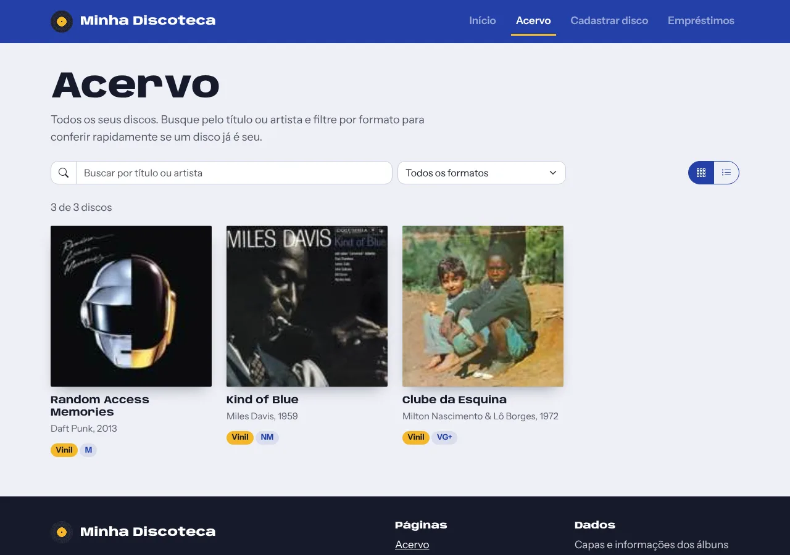
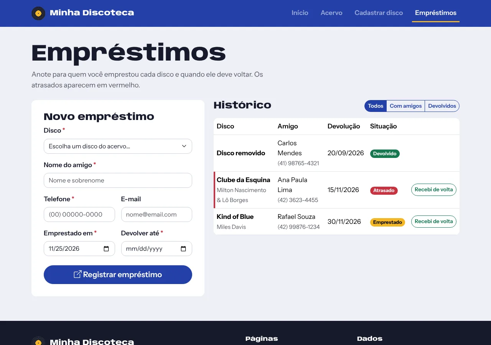
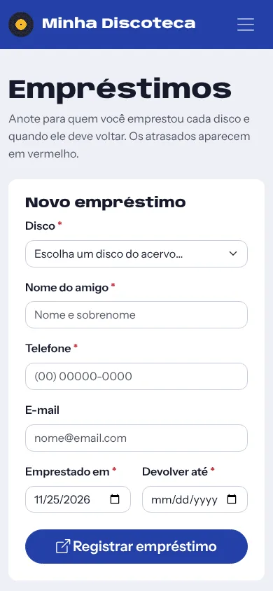
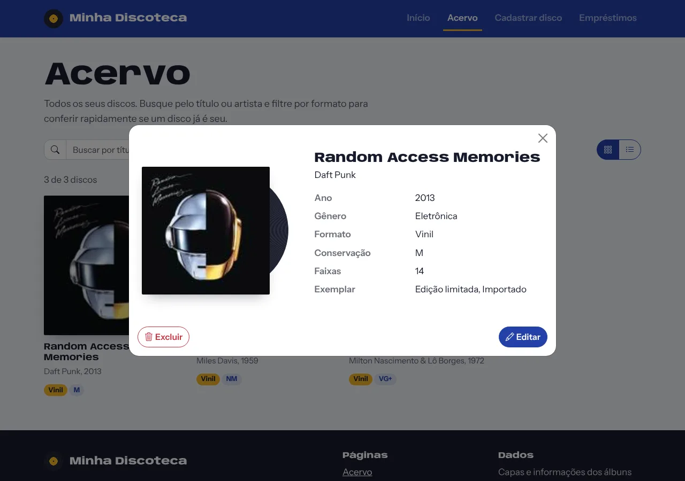

# Minha Discoteca

A estante virtual de quem coleciona vinil, CD e fita K7.

## Identificação

**Autor:** João Pedro Marcondes

## Descrição do projeto

O **Minha Discoteca** é uma aplicação web responsiva para organizar uma coleção de mídia física. O colecionador busca um álbum na **iTunes Search API**, que preenche título, artista, ano, gênero e capa, e completa o cadastro com os dados do seu exemplar: formato, estado de conservação, código de catálogo e características. O acervo aparece em grade de capas ou em lista, com busca e filtro por formato. Uma segunda área controla os **empréstimos**: para quem cada disco foi emprestado, o telefone e a data de devolução.

Os dados ficam em uma API fake (**JSON Server**) com duas entidades, `discos` e `emprestimos`. As preferências do usuário ficam no **Web Storage**.

- Requisitos do produto: [docs/prd.md](docs/prd.md)
- Arquitetura, modelo de dados e contratos das APIs: [docs/architecture.md](docs/architecture.md)

## Prototipação

- Protótipo navegável (Google Stitch): _link a ser colado após gerar o protótipo_

## Design System

- Documento do Design System (tokens de cor, tipografia, espaçamento e componentes): [docs/architecture.md#4-design-system](docs/architecture.md#4-design-system)

## Framework CSS

- **Bootstrap 5.3.8**, customizado com Sass

## Dependências

| Pacote | Versão | Uso |
| :--- | :--- | :--- |
| [bootstrap](https://getbootstrap.com/) | 5.3.8 | Framework CSS (Sass) e componentes JavaScript |
| [bootstrap-icons](https://icons.getbootstrap.com/) | 1.13.1 | Ícones |
| [jquery](https://jquery.com/) | 3.7.1 | Eventos, animações e manipulação do DOM |
| [jquery-mask-plugin](https://igorescobar.github.io/jQuery-Mask-Plugin/) | 1.14.16 | Máscara do telefone no empréstimo |
| [sass](https://sass-lang.com/) | 1.x (dev) | Compila `assets/scss/` para `app/style.css` |
| [json-server](https://github.com/typicode/json-server/tree/v0) | 0.17.4 (dev) | API fake com `discos` e `emprestimos` (`db.json`) |
| [eslint](https://eslint.org/) | 9.x (dev) | Confere erros comuns no JavaScript |
| [prettier](https://prettier.io/) | 3.x (dev) | Padroniza a formatação do código |

No site publicado, Bootstrap JS, Bootstrap Icons, jQuery e jQuery Mask vêm do CDN jsDelivr, nas mesmas versões do `package.json`.

API pública: [iTunes Search API](https://performance-partners.apple.com/search-api) (sem chave).

## Site em produção

- https://joaomarcondespedro.github.io/minha_discoteca_web-framework_API-_CSS/

O GitHub Pages só serve arquivos estáticos. Para o site publicado listar e gravar discos, rode o JSON Server no seu computador (`npm run api`): o JavaScript roda no navegador e conversa com `http://localhost:3000`. Sem ele, as páginas mostram um aviso e a busca no iTunes continua funcionando.

## Checklist de Funcionalidades

### RA1 - Utilizar Frameworks CSS para estilização de elementos HTML e criação de layouts responsivos

- [ ] ID 01 - Prototipa interfaces adaptáveis para no mínimo os tamanhos de tela mobile e desktop, usando ferramentas de design tradicionais (Figma, Quant UX ou Sketch) ou IA (Stitch).
- [x] ID 02 - Implementa layout responsivo com Framework CSS (Bootstrap, Materialize) usando Flexbox ou Grid do próprio framework.
- [x] ID 03 - Implementa layout responsivo com CSS puro, usando Flexbox ou Grid Layout.
- [x] ID 04 - Utiliza componentes prontos de um Framework CSS (ex.: card, button) e componentes JavaScript do framework (ex.: modal, carousel).
- [x] ID 05 - Cria layout fluido usando unidades relativas (vw, vh, %, em, rem) no lugar de unidades fixas (px).
- [x] ID 06 - Aplica um Design System consistente (cores, tipografia, padrões de componentes) em toda a aplicação.
- [x] ID 07 - Utiliza Sass (SCSS) com ou sem framework, aplicando variáveis, mixins e funções para modularizar o código.
- [x] ID 08 - Aplica tipografia responsiva (media queries mobile first) ou tipografia fluida (função clamp() + unidades relativas).
- [x] ID 09 – Aplica técnicas de responsividade de imagens usando CSS (object-fit, containers com unidades relativas).
- [x] ID 10 – Otimiza imagens usando formatos modernos (WebP) e carregamento adaptativo (srcset, picture, ou parâmetros do Cloudinary).

### RA2 - Realizar tratamento de formulários e aplicar validações customizadas no lado cliente

- [x] ID 11 - Implementa validação HTML nativa (campos obrigatórios, tipos, limites de caracteres) com mensagens de erro/sucesso no lado cliente.
- [x] ID 12 - Aplica expressões regulares (REGEX) para validações customizadas (e-mail, telefone, datas, etc.)
- [x] ID 13 - Utiliza elementos de seleção em formulários (checkbox, radio, select) para coleta de dados.
- [x] ID 14 - Implementa leitura e escrita no Web Storage (localStorage/sessionStorage) para persistir dados localmente.

### RA3 - Aplicar ferramentas para otimização do processo de desenvolvimento web

- [x] ID 15 - Configura ambiente com Node.js e NPM para gerenciamento de pacotes e dependências.
- [x] ID 16 - Utiliza boas práticas de versionamento no Git/GitHub (branch main ou branches específicos, uso de .gitignore).
- [x] ID 17 - Mantém um README.md padronizado, conforme template da disciplina, com checklist preenchido.
- [x] ID 18 - Organiza arquivos do projeto de forma modular, seguindo padrão de exemplo fornecido.
- [x] ID 19 - Configura linters e formatadores (ESLint, Prettier) para manter qualidade e padronização do código.

### RA4 - Aplicar bibliotecas de funções e componentes em JavaScript para aprimorar a interatividade de páginas web

- [x] ID 20 - Utiliza jQuery para manipulação do DOM e interatividade (eventos, animações, manipulação de elementos)
- [x] ID 21 - Integra e configura um plugin jQuery relevante (ex.: jQuery Mask Plugin) ou outra biblioteca de funções.

### RA5 - Efetuar requisições assíncronas para uma API fake e APIs públicas, permitindo a obtenção e manipulação de dados dinamicamente

- [x] ID 22 - Realiza requisições assíncronas para uma API fake (ex.: JSON Server) para persistir dados de um formulário.
- [x] ID 23 - Realiza requisições assíncronas para uma API fake para exibir dados na página.
- [x] ID 24 - Realiza requisições assíncronas para APIs públicas reais (OpenWeather, ViaCEP etc.), exibindo os dados e tratando erros.

## Instruções de Execução

Pré-requisitos: [Node.js LTS](https://nodejs.org/) (22.x), Git e VS Code com a extensão **Live Server**.

```bash
git clone https://github.com/Joaomarcondespedro/minha_discoteca_web-framework_API-_CSS.git
cd minha_discoteca_web-framework_API-_CSS
npm install
```

Em um terminal, suba a API fake (deixe aberto):

```bash
npm run api
```

Abra a pasta no VS Code, clique com o botão direito em `app/index.html` e escolha **Open with Live Server**.

Para editar os estilos, rode o Sass em modo de observação (ele recompila `app/style.css` a cada alteração nos `.scss`):

```bash
npm run sass:watch
```

Qualidade do código:

```bash
npm run lint          # ESLint
npm run format        # Prettier
```

Dica: antes de testar cadastros, faça uma cópia do `db.json` para voltar os dados ao estado original depois.

### Se o JSON Server não subir

No Windows, o jeito mais simples é dar dois cliques em **`iniciar-api.cmd`**, na raiz do projeto: ele entra na pasta certa, roda `npm install` na primeira vez e sobe a API. Deixe a janela aberta enquanto usa o site.

| O que aparece | Causa | Como resolver |
| :--- | :--- | :--- |
| `npm error enoent Could not read package.json` ou `Missing script: "api"` | O terminal está na pasta errada (por exemplo, a pasta acima do projeto) | `cd minha_discoteca_web-framework_API-_CSS` (ou `...-main`, se baixou o ZIP) e rode de novo |
| `'json-server' não é reconhecido` | Faltou o `npm install` nesta pasta (o ZIP do GitHub não traz a `node_modules`) | `npm install` e depois `npm run api` |
| `npm.ps1 não pode ser carregado porque a execução de scripts foi desabilitada` | Política do PowerShell no Windows | Use `npm.cmd run api`, ou troque o terminal do VS Code para **Command Prompt**, ou rode uma vez `Set-ExecutionPolicy -Scope CurrentUser RemoteSigned` |
| `'npm' não é reconhecido` | Node.js não instalado | Instale o Node.js LTS em https://nodejs.org e reabra o VS Code |
| `EADDRINUSE :::3000` | Já existe algo na porta 3000 (talvez outro JSON Server aberto) | Feche o outro terminal ou rode `npx json-server --watch db.json --port 3000` depois de encerrar o anterior |

Para conferir se a API está no ar, abra http://localhost:3000/discos no navegador: deve aparecer a lista de discos em JSON.

## Telas da Aplicação

| Desktop | Celular |
| :---: | :---: |
|  |  |
|  |  |
|  |  |
|  | |
