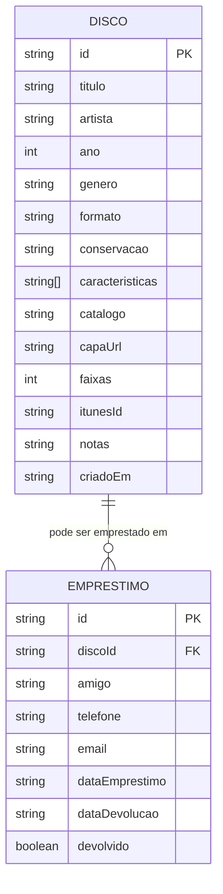

# Architecture — Minha Discoteca

> Software Design Document: o **como**. É o contrato técnico que guia o desenvolvimento (inclusive o código gerado com ajuda de IA).

## 1. Stack e versões exatas

| Camada | Tecnologia | Versão | Como entra no projeto |
| :--- | :--- | :--- | :--- |
| Framework CSS | **Bootstrap** | 5.3.8 | npm (Sass do framework) + CDN jsDelivr para o JS no site publicado |
| Ícones | Bootstrap Icons | 1.13.1 | CDN jsDelivr |
| Pré-processador | Sass (Dart Sass) | 1.x | npm (`npm run sass`) |
| Biblioteca JS | jQuery | 3.7.1 | npm / CDN |
| Plugin jQuery | jQuery Mask Plugin | 1.14.16 | npm / CDN |
| API fake | JSON Server | 0.17.4 | npm (`npm run api`) |
| API pública | iTunes Search API | v1 (sem chave) | `fetch` direto do navegador |
| Qualidade | ESLint 9 + Prettier 3 | — | npm (`npm run lint`, `npm run format`) |
| Ambiente | Node.js LTS | 22.x | — |

> **Tailwind CSS não é usado** neste projeto, conforme a regra da disciplina.

### 1.1 Por que Bootstrap 5.3

| Critério | Análise |
| :--- | :--- |
| Responsividade | Grid de 12 colunas mobile first, com breakpoints `sm`, `md`, `lg`, `xl`, `xxl`. A grade de capas usa `col-6 col-md-4 col-xl-3`: duas capas no celular, quatro no desktop, como no protótipo. |
| Componentes | Tem todos os componentes do protótipo: navbar + offcanvas, card, modal, toast, formulários com validação e tabela. |
| JavaScript | Os componentes interativos (modal, offcanvas, toast) já vêm prontos no `bootstrap.bundle` e não dependem de jQuery. |
| Customização | Todas as cores e fontes são variáveis Sass com `!default`. Basta definir os tokens antes do `@import` para o framework inteiro adotar o Design System. |
| Saúde do projeto | Repositório `twbs/bootstrap` ativo, com releases em 2025 e mais de 170 mil estrelas. |
| Licença | MIT. |

### 1.2 Por que a iTunes Search API

- É gratuita, pública e **não exige chave nem cadastro**.
- Responde com **CORS liberado**, então o `fetch` funciona direto do GitHub Pages.
- Devolve exatamente o que o cadastro de disco precisa: `collectionName`, `artistName`, `releaseDate`, `primaryGenreName`, `trackCount` e `artworkUrl100`.
- A URL da capa aceita o tamanho e o formato no próprio endereço (`.../300x300bb.webp`), o que permite montar o `srcset` em WebP (ID 10).

## 2. Modelo de dados



### 2.1 Dicionário de dados — `discos`

| Campo | Tipo | Obrigatório | Regra / exemplo |
| :--- | :--- | :---: | :--- |
| `id` | string | sim | Gerado pelo JSON Server. |
| `titulo` | string | sim | 1 a 120 caracteres. |
| `artista` | string | sim | 1 a 120 caracteres. |
| `ano` | number | não | 1900 até o ano atual (RN02). |
| `genero` | string | não | `MPB`, `Rock`, `Jazz`, `Samba`, `Bossa nova`, `Pop`, `Soul`, `Eletrônica`, `Outro`. |
| `formato` | string | sim | `Vinil`, `CD` ou `K7` (RN03). |
| `conservacao` | string | sim | Escala de colecionador: `M` (mint), `NM`, `VG+`, `VG`, `G`. |
| `caracteristicas` | string[] | não | `Primeira prensagem`, `Importado`, `Autografado`, `Edição limitada`. |
| `catalogo` | string | não | Regex RN04: `/^[A-Z]{2,8}[- ]?\d{3,6}( ?\d{1,4})?$/i`. |
| `capaUrl` | string | não | URL da capa vinda do iTunes. |
| `faixas` | number | não | Número de faixas. |
| `itunesId` | string | não | `collectionId` do iTunes. |
| `notas` | string | não | Até 280 caracteres. |
| `criadoEm` | string | sim | Data ISO 8601. |

### 2.2 Dicionário de dados — `emprestimos`

| Campo | Tipo | Obrigatório | Regra / exemplo |
| :--- | :--- | :---: | :--- |
| `id` | string | sim | Gerado pelo JSON Server. |
| `discoId` | string | sim | FK para `discos.id`. |
| `amigo` | string | sim | Nome com pelo menos 2 palavras. |
| `telefone` | string | sim | Regex RN05: `/^\(\d{2}\) \d{4,5}-\d{4}$/`. |
| `email` | string | não | Regex: `/^[\w.+-]+@[\w-]+\.[\w.-]{2,}$/`. |
| `dataEmprestimo` | string | sim | `AAAA-MM-DD`. |
| `dataDevolucao` | string | sim | `AAAA-MM-DD`, maior ou igual a `dataEmprestimo` (RN06). |
| `devolvido` | boolean | sim | Começa `false`. |

## 3. Contratos das APIs

### 3.1 API fake — JSON Server (`http://localhost:3000`)

| Método | Rota | Uso no app | ID |
| :--- | :--- | :--- | :--- |
| `GET` | `/discos?_sort=criadoEm&_order=desc` | Listagem do acervo e "últimos que entraram" | 23 |
| `GET` | `/discos/:id` | Carregar disco para edição | 23 |
| `POST` | `/discos` | Cadastrar disco | 22 |
| `PUT` | `/discos/:id` | Editar disco | 22 |
| `DELETE` | `/discos/:id` | Excluir disco | 22 |
| `GET` | `/emprestimos?_expand=disco` | Tabela de empréstimos com os dados do disco | 23 |
| `POST` | `/emprestimos` | Registrar empréstimo | 22 |
| `PATCH` | `/emprestimos/:id` | Marcar como devolvido (`{ "devolvido": true }`) | 22 |

### 3.2 API pública — iTunes Search API

```
GET https://itunes.apple.com/search?term={busca}&entity=album&country=BR&limit=12
```

Resposta (resumida):

```json
{
  "resultCount": 1,
  "results": [
    {
      "collectionId": 1473446573,
      "collectionName": "Clube da Esquina",
      "artistName": "Milton Nascimento & Lô Borges",
      "releaseDate": "1972-03-01T08:00:00Z",
      "primaryGenreName": "MPB",
      "trackCount": 21,
      "artworkUrl100": "https://is1-ssl.mzstatic.com/.../100x100bb.jpg"
    }
  ]
}
```

Tratamento de erros (ID 24): `try/catch` em volta do `fetch`, conferência de `response.ok` e mensagem na tela quando não há resultados ou a API não responde.

## 4. Design System

Conceito: **"selo de vinil"**. A interface pega emprestado o vocabulário do disco: a capa quadrada, a lombada com o nome do álbum e o selo redondo no centro do vinil. Cobalto e girassol são as cores dos selos das gravadoras brasileiras dos anos 70; o fundo frio lembra o papel da capa interna.

### 4.1 Cores (tokens)

| Token | Hex | Variável Sass | Uso |
| :--- | :--- | :--- | :--- |
| Cobalto | `#2340A8` | `$cobalto` → `$primary` | Cor principal: navbar, hero, botões primários, links. |
| Girassol | `#F4B728` | `$girassol` → `$warning` | Destaque: selo do vinil, badge de formato, foco. |
| Tinta | `#171A2C` | `$tinta` → `$dark` / `$body-color` | Texto principal e rodapé. |
| Capa interna | `#EEF0F6` | `$capa-interna` → `$body-bg` | Fundo da aplicação. |
| Papel | `#FFFFFF` | `$papel` | Superfície de cards, modais e formulários. |
| Carmim | `#C8323F` | `$carmim` → `$danger` | Erros, excluir, empréstimo atrasado. |
| Verde selo | `#17784F` | `$verde-selo` → `$success` | Sucesso, devolvido. |

Contraste: texto Tinta sobre Capa interna = 15,1:1; texto branco sobre Cobalto = 8,9:1; Tinta sobre Girassol = 9,5:1; branco sobre Carmim = 5,3:1; branco sobre Verde selo = 5,5:1 (todos acima do mínimo AA de 4,5:1).

### 4.2 Tipografia

| Papel | Fonte | Pesos | Por quê |
| :--- | :--- | :--- | :--- |
| Títulos (display) | **Anybody** | 700–800, largura expandida (`font-stretch` de 110% a 120%) | Fonte de largura variável que lembra a tipografia larga das lombadas e dos selos de LP. |
| Texto e formulários | **Instrument Sans** | 400, 500, 600 | Sans-serif neutra, ótima leitura em tamanhos pequenos (metadados do disco). |

Escala tipográfica fluida com `clamp()` (ID 08), gerada pela função Sass `fluido($min, $max)`:

| Elemento | Mínimo (celular) | Máximo (desktop) |
| :--- | :--- | :--- |
| `h1` / hero | 2.25rem | 3.75rem |
| `h2` | 1.6rem | 2.5rem |
| `h3` | 1.25rem | 1.6rem |
| corpo | 1rem | 1.0625rem |

### 4.3 Espaçamento, bordas e sombras

- Espaçamento em múltiplos de **0.5rem**, pela função Sass `espaco($n)` (ex.: `espaco(3)` = `1.5rem`).
- Raios com hierarquia: capa do disco `2px` (capa é quadrada), cards `0.75rem`, modal `1.25rem`, botões e badges `999px` (formato de selo).
- Uma única sombra, `sombra-capa`, para dar volume às capas (mixin `@include sombra-capa`).

### 4.4 Componentes do Bootstrap usados (substituição do protótipo)

| Componente do protótipo | Componente Bootstrap | Página |
| :--- | :--- | :--- |
| Barra de navegação + menu do celular | `navbar` + `offcanvas` (JS) | Todas |
| Capa do disco na estante | `card` | Início, Acervo |
| Ficha do disco | `modal` (JS) | Acervo |
| Aviso de "salvo" | `toast` (JS) | Cadastro, Empréstimos |
| Formulários | `form-control`, `form-select`, `form-check`, `btn-check`, `was-validated` | Cadastro, Empréstimos |
| Lista de empréstimos | `table`, `table-responsive`, `badge` | Empréstimos |

## 5. Organização dos arquivos

Estrutura modular sugerida na disciplina (ID 18):

```
/
├── index.html                  redireciona para app/ (endereço raiz do GitHub Pages)
├── app/
│   ├── index.html              página inicial
│   ├── style.css               CSS global, compilado do Sass (não editar à mão)
│   ├── index.js                JavaScript da página inicial
│   ├── pages/
│   │   ├── acervo/             index.html  acervo.css  acervo.js
│   │   ├── cadastro/           index.html  cadastro.css  cadastro.js
│   │   └── emprestimos/        index.html  emprestimos.css  emprestimos.js
│   ├── model/                  Disco.js  Emprestimo.js
│   ├── service/                api.js (JSON Server)  itunes.js (API pública)
│   └── util/                   validacao.js  storage.js  ui.js
├── assets/
│   ├── scss/                   main.scss  _tokens.scss  _funcoes.scss  _mixins.scss  _base.scss  _componentes.scss
│   └── img/                    imagens em WebP (3 larguras cada)
├── docs/                       prd.md  architecture.md  img/
├── db.json                     banco do JSON Server
├── package.json
├── eslint.config.js  .prettierrc  .gitignore
```

## 6. Web Storage

| Chave | Storage | Conteúdo | Por quê |
| :--- | :--- | :--- | :--- |
| `md:visualizacao` | `localStorage` | `"grade"` ou `"lista"` | Preferência que deve durar entre visitas. |
| `md:filtros` | `localStorage` | `{ "busca": "", "formato": "" }` | Volta ao acervo com o último filtro usado. |
| `md:rascunho` | `sessionStorage` | objeto com os campos do cadastro | Rascunho só da aba atual: some ao fechar a aba, como um formulário em edição. |
